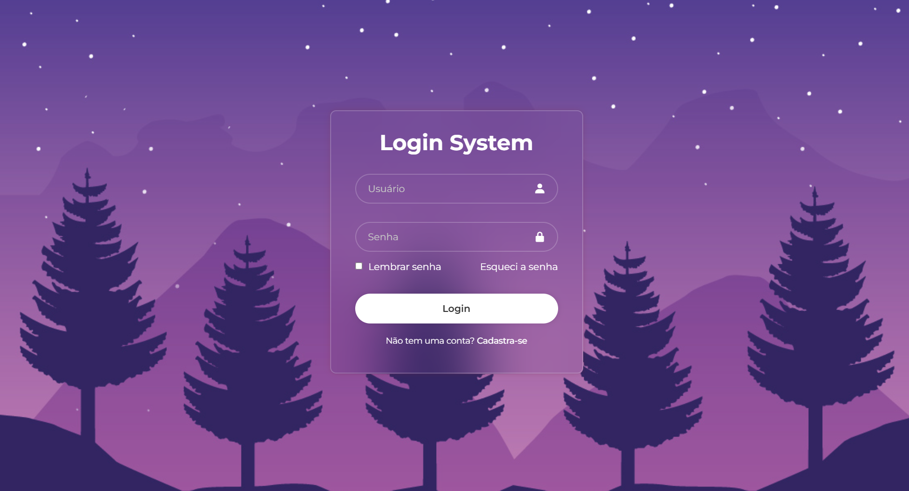

# 🔐 Tela de Login OM Tech

Uma tela de login simples feita com HTML e CSS.

## 📸 Preview

## 🚀 Como ver o projeto
1. Baixe ou clone o repositório
2. Abra o arquivo `index.html` no navegador

## 🛠️ Tecnologias
- HTML5
- CSS3

## 📚 O que eu pratiquei
- Estrutura de formulário
- Estilização com CSS
- Centralização de elementos
- Atributos Especiais no HTML

## 👤 Autor
Otávio Macêdo - [LinkedIn](https://www.linkedin.com/in/otaviomacedo23) | [GitHub](https://github.com/otaviomacedo2311x)
